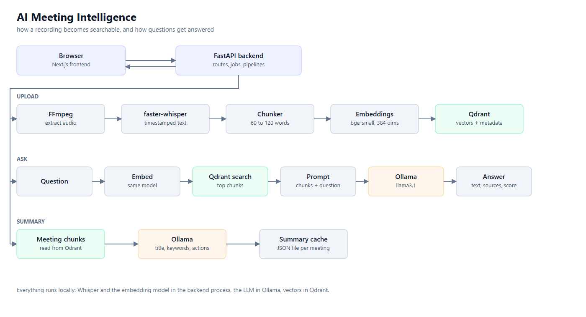

# AI Meeting Intelligence

A web app that turns meeting recordings into something you can search and ask questions about. You upload a video, it gets transcribed and indexed, and afterwards you can read a summary, browse the transcript, or ask things like "what did we decide about the deployment?" and get an answer with the exact passages and timestamps it came from.



## How it works

Uploading a meeting:

1. FFmpeg pulls the audio out of the video.
2. Whisper (faster-whisper) transcribes it into timestamped segments.
3. The transcript is split into chunks of roughly 60 to 120 words.
4. Each chunk is embedded with a sentence-transformers model and stored in Qdrant together with its text, timestamps and meeting info.

Asking a question:

1. The question is embedded the same way.
2. Qdrant returns the closest chunks (optionally only from one meeting).
3. Those chunks and the question go into a prompt for a local LLM running in Ollama.
4. The answer comes back with the chunks it was based on and a confidence score, which is the average similarity of those chunks.

Summaries work on the indexed chunks of a meeting and produce a title, summary, keywords and action items. They are saved after the first run.

The full design, with diagrams for every step, is in [docs/architecture.md](docs/architecture.md).

## Tech stack

| Part | What we use |
| --- | --- |
| Backend | Python, FastAPI |
| Speech to text | faster-whisper (`base` model, CPU) |
| Embeddings | sentence-transformers, `BAAI/bge-small-en-v1.5` |
| Vector database | Qdrant |
| LLM | Ollama, `llama3.1` |
| Frontend | Next.js, TypeScript, Tailwind CSS, TanStack Query |

## Project layout

```
app/
  api/          FastAPI routes and request/response schemas
  config/       settings (models, chunk sizes, Qdrant, LLM)
  models/       dataclasses passed between the layers
  pipelines/    video, indexing, query and summary workflows
  prompts/      prompt builders and the factory that picks them
  services/     transcription, chunking, embeddings, retrieval, LLM, ...
  utils/        ffmpeg, file and JSON helpers
  vectorstore/  Qdrant client wrapper
docs/           architecture notes and diagram
frontend/       Next.js app
scripts/        small command line scripts to try each pipeline
```

Pipelines decide what happens and in which order, services do the actual work, and models are just the data that moves between them.

## Running it locally

You need:

- Python 3.11 or newer
- Node.js 20 or newer
- FFmpeg on your PATH
- Qdrant on port 6333
- Ollama with the `llama3.1` model

Start Qdrant and pull the model:

```
docker run -p 6333:6333 qdrant/qdrant
ollama pull llama3.1
```

Backend, from the project root:

```
pip install -r requirements.txt
uvicorn app.main:app --reload
```

It runs on http://localhost:8000 and the interactive API docs are at http://localhost:8000/docs. The first upload is slow because the Whisper and embedding models are downloaded and loaded.

Frontend, in another terminal:

```
cd frontend
npm install
npm run dev
```

Open http://localhost:3000.

To try a pipeline without the web app, the scripts folder has one for each, for example:

```
python scripts/test_video_pipeline.py path/to/meeting.mp4
```

## Offline Windows app

`build_exe.ps1` builds `dist\AIMeeting`: a small Rust window (`desktop/`, wry + WebView2) that starts the packaged backend (`AIMeetingCore.exe`, with embedded Qdrant and bundled Whisper, bge and ffmpeg) and shows the UI in its own app window. Closing the window stops the backend. Needs Rust, Python 3.14 with the project venv, and the Next static export in `web\`. Ollama with `llama3.1` is still required for summaries and Ask AI. `installer\AIMeeting.iss` wraps the folder into a setup exe with Inno Setup.

## API

| Method | Path | What it does |
| --- | --- | --- |
| GET | `/health` | liveness check |
| POST | `/api/v1/uploads` | upload a video, processing runs in the background, returns a job id |
| GET | `/api/v1/uploads/{job_id}` | job status and current stage |
| POST | `/api/v1/meetings/upload` | upload and process in a single request (slow) |
| POST | `/api/v1/indexing` | upload several videos at once |
| GET | `/api/v1/meetings` | list indexed meetings |
| GET | `/api/v1/meetings/{id}` | one meeting |
| GET | `/api/v1/meetings/{id}/transcript` | transcript by chunk |
| DELETE | `/api/v1/meetings/{id}` | remove a meeting from the index |
| POST | `/api/v1/meetings/{id}/summary` | generate a summary (`?refresh=true` to redo it) |
| GET | `/api/v1/meetings/{id}/summary` | saved summary |
| POST | `/api/v1/meetings/{id}/query` | ask a question about one meeting |
| POST | `/api/v1/query` | ask a question across all meetings |

## Configuration

Models, chunk sizes, the Qdrant address and the retrieval settings are in [app/config/settings.py](app/config/settings.py).

A few things can be set with environment variables:

| Variable | Default | Meaning |
| --- | --- | --- |
| `CORS_ALLOW_ORIGINS` | `http://localhost:3000,http://127.0.0.1:3000` | origins allowed to call the API |
| `MAX_UPLOAD_SIZE_BYTES` | 500 MB | largest accepted video |
| `NEXT_PUBLIC_API_URL` | `http://localhost:8000` | backend address used by the frontend |

Supported video formats are mp4, mkv, mov, avi, webm and m4v.

## Known limitations

- Upload jobs are kept in memory, so they are lost when the server restarts.
- Videos are processed one at a time.
- The meeting list is read from Qdrant, so meetings indexed before upload dates were stored show no date.
- The original video is not served back, so the app cannot jump to a timestamp in the recording.
- No users or login, everything is in one shared space.

## Ideas for later

PostgreSQL for meeting records, user accounts and workspaces, export to PDF or DOCX, decision and topic extraction, and background workers with a queue for heavier loads.

## Authors

Vednarayan Hiralkar and Arjun Dasalkar, B.Tech Computer Science and Engineering (2023 to 2027).

## License

See [LICENSE](LICENSE).
